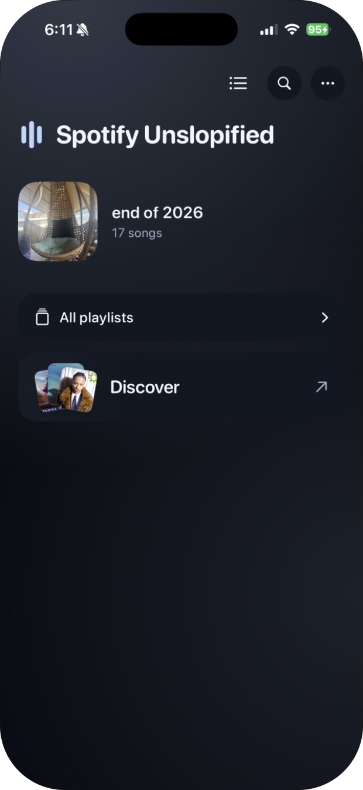
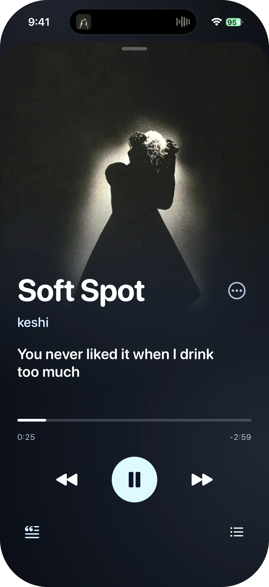
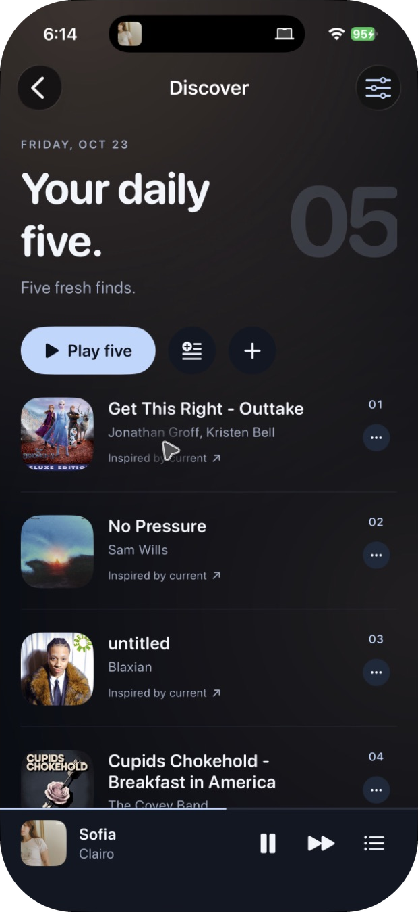

# Spotify Unslopified

**Spotify without the slop. A focused, minimal Spotify remote for iPhone.**

  
  
  

Your playlists up front. Search when you want it. No recommendations feed to scroll past.

- Choose exactly which playlists appear on Home.
- Browse songs, albums and artists; manage playlists and your queue.
- Follow live lyrics, search by lyrics, or set a sleep timer.
- Import your own music into playlists, with covers, song details and timed lyrics.
- Opt into **Discover** for five songs a day, inspired by playlists you choose.

Built with SwiftUI for **iOS 26+**. Spotify tracks play through the Spotify app. Imported audio plays on the device.

## Get it running

You'll need a Mac with **Xcode 26+**, an iPhone running **iOS 26+**, and **Spotify Premium**. This is a build-it-yourself app; each person uses their own free Spotify developer app.

1. **Download** this repo (Code → Download ZIP, then unzip) and open `Focused.xcodeproj`.
2. **Configure** your Spotify app and Apple signing using the [short setup guide](docs/SETUP.md).
3. **Run** on your iPhone with **⌘R**, then tap **Connect Spotify**.

Just looking? Run in the iPhone simulator and tap **Try with sample music**. No Spotify setup required.

## Imported playlists

Create a playlist from **All playlists → Imported**, then add audio from Files. Imported songs play on your device, with editable titles, artists, creation dates, artwork and lyrics.

To share your library with the [Spotify Unslopified Chrome extension](https://github.com/noah-jacksonn/spotify-unslopified-web):

1. Create a dedicated iCloud Drive folder, such as **Unslopified Music**.
2. Choose **Connect music folder** in the iPhone app and select that parent folder. Connect the same folder in the extension on your Mac, using the same iCloud account.
3. Each subfolder becomes a playlist. Import songs in either app or drop audio into a playlist folder in Finder. Both apps pick up changes after iCloud finishes syncing; use Refresh if needed.

For example, download your songs from **Suno AI**, create a **Suno** playlist, and import them to listen on iPhone and Mac. Save each song's Suno source link to let the Chrome extension fetch missing timed lyrics while a signed-in Suno tab is open. The lyrics are saved beside the audio and shared with iPhone too. Ordinary audio files also work; Suno is optional.

The folder menu includes **Copy device playlists here** for earlier imports. It copies the audio, covers and song details and preserves the original device library. Disconnecting returns to that library. Downloaded tracks remain available offline. iCloud handles the transfers; no separate sync account or backend is needed. These are imported playlists in Unslopified, separate from Spotify's catalog playlists.

## A few limits

Spotify's development API only lets us read the contents of playlists you own or collaborate on. Other playlists show their details. Spotify also doesn't let this remote remove or reorder songs already in its playback queue. The sleep timer won't survive force-quitting the app.

## Under the hood

No backend or analytics. Spotify sign-in uses PKCE; tokens stay in the device Keychain. Spotify-song lyrics come from [LRCLIB](https://lrclib.net), and lyric search sends your typed phrase to Genius. Imported lyrics stay with your files; the Chrome extension can fetch Suno timing directly from Suno. Discover uses Spotify's catalog, without an AI service.

[Report a bug or suggest something](https://github.com/noah-jacksonn/spotify-unslopified-ios/issues) · [Development](docs/DEVELOPMENT.md) · [MIT license](LICENSE)

Independent project; not affiliated with Spotify. Spotify's SDK and service have their own terms.
