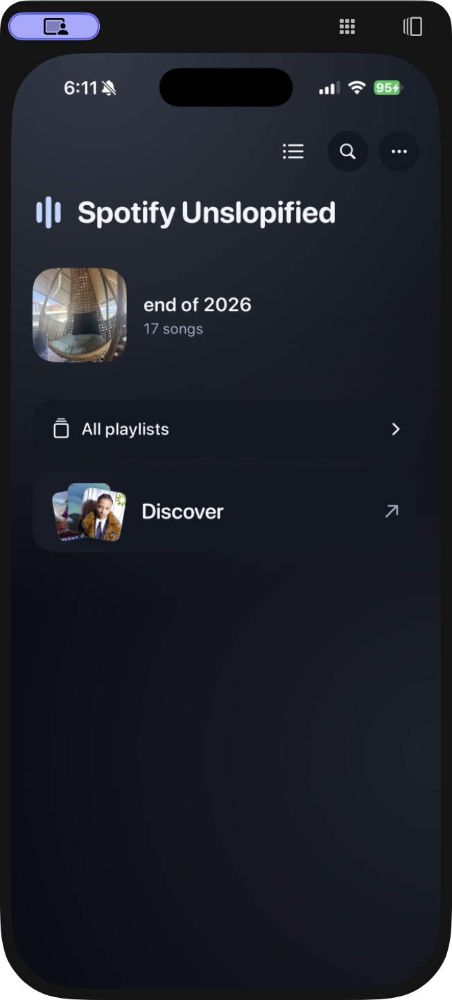
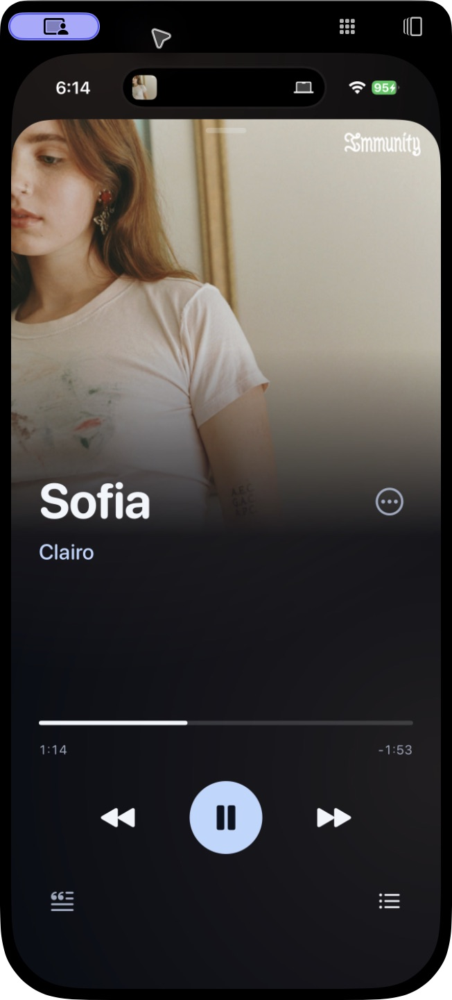
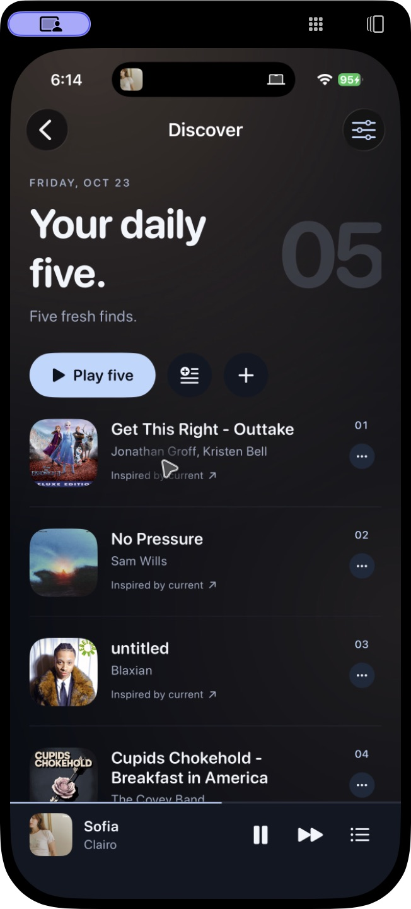

# Spotify Unslopified

**Spotify without the slop. A focused, minimal Spotify remote for iPhone.**

  
  
  

Your playlists up front. Search when you want it. No recommendations feed to scroll past.

- Choose exactly which playlists appear on Home.
- Browse songs, albums and artists; manage playlists and your queue.
- Follow live lyrics, search by lyrics, or set a sleep timer.
- Opt into **Discover** for five songs a day, inspired by playlists you choose.

Built with SwiftUI for **iOS 26+**. Music plays through the Spotify app.

## Get it running

You'll need a Mac with **Xcode 26+**, an iPhone running **iOS 26+**, and **Spotify Premium**. This is a build-it-yourself app; each person uses their own free Spotify developer app.

1. **Download** this repo (Code → Download ZIP, then unzip) and open `Focused.xcodeproj`.
2. **Configure** your Spotify app and Apple signing using the [short setup guide](docs/SETUP.md).
3. **Run** on your iPhone with **⌘R**, then tap **Connect Spotify**.

Just looking? Run in the iPhone simulator and tap **Try with sample music**. No Spotify setup required.

## A few limits

Spotify's development API only lets us read the contents of playlists you own or collaborate on. Other playlists show their details. Spotify also doesn't let this remote remove or reorder songs already in its playback queue. The sleep timer won't survive force-quitting the app.

## Under the hood

No backend or analytics. Spotify sign-in uses PKCE; tokens stay in the device Keychain. Lyrics come from [LRCLIB](https://lrclib.net), and lyric search sends your typed phrase to Genius. Discover uses Spotify's catalog, without an AI service.

[Report a bug or suggest something](https://github.com/noah-jacksonn/spotify-unslopified-ios/issues) · [Development](docs/DEVELOPMENT.md) · [MIT license](LICENSE)

Independent project; not affiliated with Spotify. Spotify's SDK and service have their own terms.
